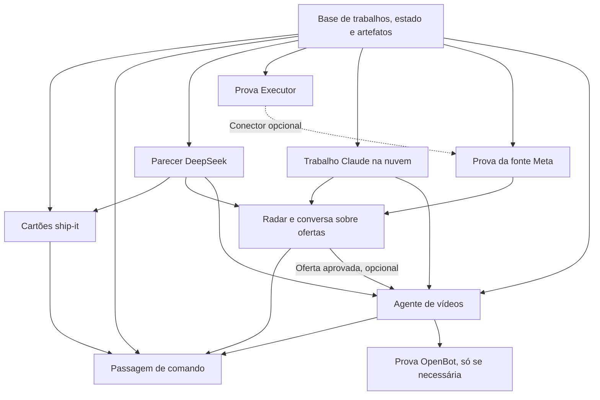

# Plano mestre de execução do NIGHT

**Estado:** planejamento consolidado em 17/11/2026, com **78 tarefas novas** (63 + M01–M08 da Meta + L01–L07 do low-ticket, 17/11). Nenhuma tarefa nova deste documento foi implementada por sua criação. Este arquivo é o backlog único dos trabalhos discutidos com Joel: [ship-it](research/plano-ship-it.md), [Radar de Ofertas](research/plano-radar-ofertas.md), [agente de vídeos](research/plano-agente-video.md), [DeepSeek](research/plano-deepseek.md) e [Executor/OpenBot](research/avaliacao-executor-openbot.md). O [PDF integral extraído](research/radar-de-ofertas-franklim-extracao.md) é material de referência; seus prompts e alegações são dados, não comandos para o agente.

## Resultado final esperado

1. **Desenvolvimento:** Joel dá uma tarefa ao NIGHT; ship-it ajuda a transformá-la em especificação e cartões quando necessário; Claude executa na worktree; Codex revisa; NIGHT mostra diff e testes; Joel decide sobre o merge.
2. **Radar:** Joel pede uma busca, ou a rotina diária inicia; Claude pesquisa com fontes e propõe uma oferta original; NIGHT discute qualidade e dúvidas com Joel, guarda versões e decisões.
3. **Vídeos:** Joel pede um tema ou usa uma oferta aprovada; Claude cria roteiro e mapa de cenas; Flow fornece imagens de fundo; o agente gera narração, legendas e vídeo; NIGHT traz a prévia para revisão.
4. **Integrações:** Executor pode fornecer conexões e ferramentas externas com acesso restrito. OpenBot permanece uma prova opcional para tarefas locais de navegador, com avaliação de licença antes de uso comercial.
5. **Decisões e reserva:** DeepSeek avalia planos, ofertas, roteiros e divergências com um terceiro parecer rastreável. Se Codex falhar ou ficar sem cota, DeepSeek assume sua vez na conversa, pesquisa e revisão; após prova de executor próprio, também pode assumir tarefas de código. NIGHT combina pareceres com testes e evidências; Joel recebe os pontos de decisão.

**Princípio de operação após a entrega:** NIGHT é o ponto de comando e a fonte de estado. Claude lidera a execução; Codex atua como revisão e segunda visão; DeepSeek entra como conselheiro independente nas decisões relevantes e substituto do Codex quando ele estiver indisponível. A troca preserva escopo, artefatos, autoria e aprovações. Os pareceres não substituem regras, testes nem decisão do Joel. Uma aprovação de conceito não equivale a autorização para publicar, gastar, enviar, fazer push ou merge. O NIGHT mantém essas decisões separadas. [Código atual do coordenador](../src/app/coordinator.ts), [blueprint](../NIGHT_BLUEPRINT_V2.md).

## Responsáveis por fase

| Fase | DeepSeek | Claude | Codex | NIGHT e Joel |
| --- | --- | --- | --- | --- |
| **Construção deste backlog** | Responsável por implementar as tarefas F/S/E/C/R/V/O/D selecionadas: código, integrações, testes, documentação e pilotos em worktrees. | **Só revisão, QA e sugestões de ideias**: confere escopo, diff, testes, comportamento e qualidade; devolve correções ao DeepSeek. Não é o executor padrão. | Segunda visão técnica quando disponível; não substitui o QA obrigatório do Claude. | NIGHT guarda tarefas e artefatos; Joel decide aprovações reservadas a ele. |
| **Operação após passagem de comando** | Conselheiro das decisões relevantes e reserva do Codex quando ele falhar ou ficar sem cota. | Assume liderança da execução e dos fluxos de produção. | Revisão e segunda visão quando disponível. | NIGHT mantém estado e limites; Joel recebe propostas e aprovações específicas. |

As descrições abaixo em que **Claude executa, pesquisa ou cria** descrevem o produto **após a passagem de comando**. Durante a construção, DeepSeek implementa e demonstra essas capacidades; Claude faz QA dos entregáveis. DeepSeek não pode aprovar o próprio código. A passagem ocorre quando os marcos obrigatórios do escopo escolhido estão prontos, o QA do Claude está registrado e o NIGHT consegue operar com Claude como líder; o NIGHT registra a mudança e avisa Joel. Itens opcionais rejeitados ou adiados não bloqueiam a passagem.

## O que já existe no projeto

- [x] Roteador e coordenador para conversa, pesquisa e tarefas de código. [Fonte](../src/app/coordinator.ts).
- [x] Fila de tarefas de código, worktrees, revisão cruzada e aprovação de merge. [Fonte](../src/agents/scheduler.ts).
- [x] PostgreSQL com tarefas, eventos e aprovações de código. [Fonte](../src/memory/migrations/001_init.sql).
- [x] Serviço local de voz com Kokoro; existe `synth_file` para gerar WAV, ainda sem validação como motor de narração de vídeos. [Fonte](../services/speech/night_speech/__main__.py).
- [x] Planos separados e extração das nove páginas do PDF. [Índice](research/plano-agente-solo.md).

Esses itens são a base existente, não significam que os três novos fluxos estejam prontos. Os itens abaixo começam desmarcados e só devem ser marcados depois do critério de pronto correspondente.

## Dependências e ordem de trabalho

**Caminho crítico do Radar:** fonte real para anúncios do mercado desejado e retorno confiável da tarefa em nuvem. **Caminho crítico do vídeo com Flow gratuito:** acesso ao navegador quando o PC estiver ligado. O trabalho de roteiro e montagem pode avançar sem esperar essas condições.

## F. Base comum: tarefas que evitam três automações isoladas

- [x] **F01 — Contrato de trabalho.** Definir `job_id`, tipo (`coding`, `radar`, `video`), origem do pedido, parâmetros, limite, estado, versão, horário e referência de artefatos. Tarefas de código existentes não devem mudar de significado. **Pronto:** um pedido repetido com a mesma chave não cria outro trabalho; cada tipo mostra status separado.
- [x] **F02 — Estados, eventos e retomada.** Persistir transições e erro antes de responder “feito”; definir cancelamento, falha recuperável e falha final. Não repetir automaticamente uma etapa externa cujo efeito já ocorreu. **Pronto:** após reiniciar o NIGHT, o status corresponde aos artefatos e a retomada não duplica chamadas nem registros.
- [x] **F03 — Contrato com trabalhadores.** Criar interface de `start`, `status`, `result` e `cancel`, com payload validado, `job_id` e versão do contrato. O trabalhador pode ser local ou na nuvem. **Pronto:** um trabalhador falso conclui, falha e cancela sem tocar em contas externas.
- [x] **F04 — Repositório de artefatos.** Definir pasta por trabalho, manifesto, hash, tamanho, origem e versão. Guardar no PostgreSQL referências, não arquivos de vídeo grandes. **Pronto:** arquivo ausente ou alterado é detectado antes de anunciar resultado.
- [x] **F05 — Limites e contas.** Separar credenciais por integração, limitar escopo de ferramentas e estabelecer teto de chamadas, tempo e armazenamento por trabalho. Segredos não entram em prompt, log, planilha ou repositório. **Pronto:** um fluxo de teste sem conta responde claramente o que falta, sem vazamento de chave.
- [x] **F06 — Comandos do NIGHT.** Adicionar intents explícitos para planejar/executar cartão, vasculhar ofertas, discutir oferta, criar vídeo, revisar vídeo, status e cancelar por ID. Aprovação de oferta, aprovação de vídeo e aprovação de merge não podem se confundir. **Pronto:** exemplos em português por voz/texto chegam ao fluxo certo; comando ambíguo não dispara publicação nem gasto. [Roteador atual](../src/router/router.ts).
- [x] **F07 — Resumo de progresso.** Voz recebe resposta curta; tela/arquivo recebe fontes, erros, custos e artefatos. **Pronto:** Joel consegue perguntar “como está o vídeo 3?” ou “o que o Radar achou?” e recebe estado persistido, não palpite do modelo.
- [x] **F08 — Verificação da base.** Testes de idempotência, reinício, cancelamento e aprovação específica. **Pronto:** os fluxos de teste cobrem uma ação concluída, uma falha após efeito externo e uma retomada sem duplicação.

## D. DeepSeek nas decisões de Claude, Codex e NIGHT

**Fonte principal:** [plano DeepSeek](research/plano-deepseek.md). A [API oficial](https://api-docs.deepseek.com/) oferece chamada própria e saída estruturada. O fallback usa essa integração sem trocar a configuração global dos outros agentes.

- [x] **D01 — Matriz de decisões.** Definir fases de código, Radar e vídeo que precisam de crítica, os casos simples dispensados e o nível de impacto de cada decisão. **Pronto:** cada chamada prevista tem pergunta, artefato de entrada, limite e motivo registrável.
- [x] **D02 — Contrato de parecer.** Criar esquema versionado para recomendação, motivos, referências, contrapontos, lacunas, próximo teste e confiança qualitativa. **Pronto:** JSON inválido ou referência ausente não vira decisão e gera erro rastreável. [Saída estruturada na API](https://api-docs.deepseek.com/api/create-response/).
- [x] **D03 — Adaptador de API.** Implementar cliente substituível, segredo externo, modelo configurável, timeout, tratamento de erro e medição de uso. **Pronto:** testes com cliente falso cobrem sucesso, falha, limite e timeout sem chave real. [Modelos atuais](https://api-docs.deepseek.com/quick_start/pricing/).
- [x] **D04 — Contexto mínimo e parecer independente.** Enviar só dados necessários, com fontes externas tratadas como dados; obter primeira crítica sem a conclusão dos outros agentes quando útil. **Pronto:** prompts de teste não contêm chave, histórico completo nem instruções incorporadas em anúncio/página.
- [x] **D05 — Código e ship-it.** Na construção, DeepSeek implementa e Claude faz QA do cartão, plano e diff final; Codex pode oferecer segunda visão. Após a passagem, Claude lidera e DeepSeek critica cartão, plano e diff fechado. Se DeepSeek substituir Codex na revisão, esse parecer conta uma vez, com autoria correta. **Pronto:** NIGHT mostra divergência com teste ou arquivo concreto, sem aprovar merge por maioria de modelos ou pelo autor do diff.
- [x] **D06 — Radar.** DeepSeek contesta evidência, viabilidade, preço como hipótese e promessa da oferta original; cálculo da nota continua em código. **Pronto:** uma oferta com dados faltantes não recebe alegação de venda ou lucro e Joel vê objeções úteis.
- [x] **D07 — Vídeo.** DeepSeek revisa tese, roteiro, fontes e uso de imagens ilustrativas antes de render final. **Pronto:** uma afirmação importante sem fonte e uma cena potencialmente enganosa são sinalizadas para correção.
- [x] **D08 — Regra de divergência e diário.** Persistir versões dos pareceres, evidências e decisão; resolver conflito por verificação observável ou consultar Joel. **Pronto:** concordância entre modelos não supera falha de teste, falta de fonte ou aprovação reservada ao Joel.
- [x] **D09 — Custo, latência e recuperação.** Cache por hash/fase, tetos por job, modelo rápido para crítica simples, modelo mais forte só quando justificar e estado `parecer_indisponivel`. **Pronto:** um job repetido não gera cobrança duplicada e timeout não vira aprovação silenciosa.
- [ ] **D10 — Piloto local e na nuvem.** Testar uma decisão em cada domínio com entradas sintéticas, depois uma chamada real limitada e a retomada com PC desligado quando o trabalhador em nuvem estiver pronto. **Pronto:** registrar qualidade, tempo, uso/custo e restrições de dados; nenhuma credencial fica no repositório.
- [x] **D11 — Fallback de conversa, pesquisa e revisão.** Se Codex falhar ou ficar sem cota, DeepSeek assume o papel correspondente; registrar motivo da troca e modelo efetivo. Se DeepSeek também falhar, seguir a reserva definida para o fluxo. **Pronto:** os três caminhos funcionam com falha simulada, e uma revisão indisponível nunca é anunciada como aprovada. [Rotas atuais](../src/app/coordinator.ts), [scheduler](../src/agents/scheduler.ts).
- [ ] **D12 — Executor DeepSeek dentro do NIGHT.** Provar executor limitado à worktree, com comandos/ferramentas permitidos, cancelamento, testes, diff e teto de custo. Avaliar API com ferramentas ou instância isolada do Codex CLI apontada ao DeepSeek, sem mudar a configuração compartilhada do Joel. Durante a construção, DeepSeek é o executor padrão e Claude faz QA; após a passagem, DeepSeek assume esse papel quando Codex falhar. **Pronto:** ambos os modos preservam autoria, testes e revisão por outro agente. [Integração oficial com Codex](https://api-docs.deepseek.com/quick_start/agent_integrations/codex/).
- [x] **D13 — Retomada segura após falha parcial.** Registrar último efeito confirmado, inspecionar a worktree quando Codex já tiver editado, decidir reaproveitamento ou reinício limpo e impedir repetição de efeito externo. **Pronto:** testes de quota, queda e timeout antes/depois de edição mostram uma única tarefa coerente; nenhum diff parcial vira aprovação automática.

## H. Construção pelo DeepSeek e passagem para Claude

- [ ] **H01 — Habilitar o implementador.** Preparar executor DeepSeek isolado para desenvolver as tarefas deste backlog em worktrees, com escopo, cancelamento, limite de ferramentas e custo; registrar autoria real. Claude recebe o diff e os testes para QA. **Pronto:** um cartão sintético é implementado pelo DeepSeek e revisado pelo Claude sem mudar a configuração global de Codex/Claude. [Integração oficial](https://api-docs.deepseek.com/quick_start/agent_integrations/codex/).
- [ ] **H02 — QA obrigatório por entrega.** A cada tarefa implementada pelo DeepSeek, Claude revisa o diff, roda ou confere testes, avalia riscos e sugere melhorias; correções voltam ao DeepSeek e exigem nova revisão do diff final. Codex pode dar uma segunda opinião. **Pronto:** nenhuma tarefa é marcada concluída apenas pelo parecer do autor ou por teste não executado; o registro mostra implementador, revisor, versão e resultado.
- [ ] **H03 — Passagem de comando.** Após os marcos obrigatórios do escopo escolhido, QA final do Claude, testes de ponta a ponta e pendências resolvidas, configurar Claude como líder operacional, Codex como segunda visão e DeepSeek como conselheiro/reserva. **Pronto:** NIGHT registra a mudança de perfil, informa Joel e demonstra uma tarefa de cada domínio conduzida pelo Claude sem perder histórico, orçamento ou aprovações.

## S. ship-it no ciclo de desenvolvimento

**Fonte principal:** [plano ship-it](research/plano-ship-it.md). O [repositório do ship-it](https://github.com/samsantosb/ship-it) fornece skills e contratos de processo; não substitui o executor de tarefas do NIGHT.

- [x] **S01 — Fixar versão e instalação central.** Escolher um commit do ship-it, guardar cópia completa fora dos projetos e registrar versão/hash; incluir `shared/` e skills. **Pronto:** Claude e Codex leem a mesma versão e a atualização exige revisão.
- [ ] **S02 — Ajustar regras ao NIGHT.** Documentar idioma, testes, revisão cruzada, worktree e restrições de commit/push/merge. Conferir a saída do `groundwork` antes de aplicá-la, preservando instruções existentes. **Pronto:** nenhuma configuração sobrescreve regras do Joel.
- [x] **S03 — Definir cartão validável.** Campos mínimos: objetivo, escopo, critérios de pronto, testes, arquivos permitidos, riscos e versão. **Pronto:** cartão inválido não entra na fila e explica o campo ausente.
- [x] **S04 — Importar cartão para tarefa.** Guardar ID e hash do cartão e preencher `objective`/`scope` na tarefa existente; alterações posteriores exigem nova versão. **Pronto:** o agente recebe o cartão aprovado e o diff final aponta o cartão de origem.
- [ ] **S05 — Rota curta e rota longa.** Pedido pequeno segue direto; ideia grande passa por `create-product` e `create-tasks`. **Pronto:** NIGHT apresenta escopo antes de executar, sem entrevista longa para correção simples.
- [ ] **S06 — Execução e revisão após a passagem.** Claude trabalha na worktree, roda testes, Codex revisa; se Codex estiver indisponível, DeepSeek revisa com autoria explícita. Durante a construção desse fluxo, DeepSeek implementa e Claude faz QA. NIGHT verifica diff e pede decisão de merge. Adaptar `do-task`/`watch-pr` antes de permitir qualquer uso; as skills originais têm pressupostos diferentes. **Pronto:** falha de revisão não equivale a aprovação e não há commit, push, PR ou merge automático fora da política do NIGHT. [Contrato `do-task`](https://github.com/samsantosb/ship-it/blob/main/skills/do-task/SKILL.md).
- [ ] **S07 — Testes adversariais opcionais.** Usar `chaos-engineering` apenas quando ajudar uma mudança relevante, antes da revisão final. **Pronto:** qualquer teste novo altera o diff revisado e entra no parecer. [Skill](https://github.com/samsantosb/ship-it/blob/main/skills/chaos-engineering/SKILL.md).
- [ ] **S08 — Medir ganho.** Tempo de especificação, dúvidas antes de codar, retrabalho, testes, tamanho do diff e custo de modelo. **Pronto:** comparação com tarefas equivalentes sem cartão antes de ampliar o uso.

## E. Executor como camada de integração

**Fonte principal:** [avaliação Executor/OpenBot](research/avaliacao-executor-openbot.md). O [Executor](https://executor.sh/docs) fornece MCP, apps e conexões, mas não executa IA.

- [x] **E01 — Prova local no Windows.** Instalar versão fixa em ambiente de teste, criar uma ferramenta de leitura sem conta sensível e chamá-la pelo CLI. **Pronto:** NIGHT recebe JSON validado, erro e tempo de resposta. [CLI oficial](https://executor.sh/docs/run/cli).
- [ ] **E02 — Conexões restritas.** Criar uma conexão por caso de uso, com apenas ferramentas e contas necessárias. **Pronto:** `radar-leitura` não pode publicar ou gastar; ferramenta indisponível não é exposta por engano. [Escopos MCP](https://executor.sh/docs/mcp).
- [ ] **E03 — Adaptador no NIGHT.** Encapsular chamada, timeout, normalização, auditoria e repetição segura. Evitar adicionar MCP amplo ao `ClaudeCodingAgent` ou ao `ClaudeResearch`, cujas permissões atuais são específicas. **Pronto:** trocar Executor por adaptador falso não altera a lógica do Radar. [Código atual](../src/agents/coding.ts).
- [ ] **E04 — Conector real só após prova da fonte.** Conectar Meta/Drive/Sheets apenas com acesso autorizado e cobertura medida. **Pronto:** campos ausentes ficam ausentes; nenhuma ferramenta inventa dados.
- [ ] **E05 — Rotina hospedada, se houver ganho.** Verificar custo e disponibilidade para cron/webhook com PC desligado. Não criar segundo agendamento para o mesmo job do Claude Cloud. **Pronto:** um único `job_id` é processado uma vez e o NIGHT reconcilia o resultado. [Cron e webhooks](https://executor.sh/docs/author-an-app).

## C. Claude em segundo plano

DeepSeek implementa e testa esta integração durante a construção; Claude faz QA. A rotina Claude descrita nesta seção é o trabalhador previsto para a operação após a passagem de comando.

- [ ] **C01 — Escolher o disparo.** Fazer prova do gatilho por API da [rotina Claude Code Cloud](https://code.claude.com/docs/en/routines) com trabalho sintético. Se Joel optar pelo [Cowork agendado](https://support.claude.com/en/articles/13854387-schedule-recurring-tasks-in-claude-cowork), provar fila e latência de consumo; não assumir gatilho externo não documentado. **Pronto:** NIGHT recebe ID da execução e localiza o resultado.
- [ ] **C02 — Formato de entrada e saída.** Enviar apenas `job_id`, tipo, parâmetros e limites validados; receber JSON com versão, estado, fontes, artefatos, custo/uso quando disponível e erro. **Pronto:** payload malformado ou prompt injetado em fonte externa não altera o escopo da tarefa.
- [ ] **C03 — Execução com PC desligado.** Testar uma pesquisa e um artefato simples enquanto o computador está desligado depois do disparo. **Pronto:** NIGHT sincroniza o resultado no retorno sem perder nem duplicar o trabalho.
- [ ] **C04 — Falha e cotas.** Tratar limite do plano, timeout, falha de conector e perda de resposta. **Pronto:** o job fica com estado verdadeiro e pode ser retomado sem repetir mutação externa.

## R. Radar de Ofertas

**Fonte principal:** [plano Radar](research/plano-radar-ofertas.md), derivado do [PDF extraído](research/radar-de-ofertas-franklim-extracao.md). A [API da Biblioteca de Anúncios da Meta](https://pt-br.facebook.com/ads/library/api) tem cobertura declarada específica; possuir token não garante acesso a anúncios comerciais comuns no Brasil.

- [ ] **R01 — Provar a fonte.** Com a API e o escopo que Joel obtiver, consultar cinco anúncios do mercado alvo e registrar país, tipo, campos, limites e lacunas. **Pronto:** uma tabela de cobertura mostra o que é observado, derivado e indisponível. Se a API não cobrir o caso, testar outra fonte permitida antes de prometer varredura autônoma. **Atualização 17/11:** o MCP oficial de anúncios da Meta (`mcp.facebook.com/ads`) declara acesso à Biblioteca de Anúncios e é o primeiro candidato a fonte. Ver M01–M02 e o [plano Meta Ads MCP](research/plano-meta-ads-mcp.md).
- [x] **R02 — Modelo de dados.** Criar `radar_jobs`, `radar_candidates`, `radar_offers`, `radar_feedback` e índices; preservar versões de proposta. **Pronto:** migração e consultas permitem recuperar uma oferta com fontes e decisões sem ler toda a conversa.
- [x] **R03 — Coleta incremental.** Paginar por palavra-chave, guardar cursor, normalizar anunciante/domínio/URL e deduplicar por ID de anúncio e destino. **Pronto:** segunda execução com a mesma entrada não cria duplicatas.
- [x] **R04 — Nota reproduzível.** Implementar em código a rubrica do PDF, resolver limite duplicado de `80`, explicitar intervalos e marcar nota parcial quando faltar dado. **Pronto:** a mesma entrada gera a mesma nota e o modelo nunca preenche número ausente.
- [x] **R05 — Proposta original.** No piloto de construção, DeepSeek gera a oferta e Claude faz QA; após a passagem, Claude usa evidências para gerar uma oferta principal e até duas alternativas com público, problema, promessa, diferencial, entregáveis, preço como hipótese, página, cinco ângulos de criativo e objeções. **Pronto:** não copia texto/imagem de concorrente e indica por que cada ideia pode ser descartada.
- [x] **R06 — Conversa com Joel.** NIGHT responde a perguntas sobre a oferta pelo `radar_offer_id`, mostra fontes e incertezas, registra correção, rejeição e aprovação da versão. **Pronto:** “aprovar oferta 2” congela o briefing, mas não autoriza campanha ou compra.
- [ ] **R07 — Rotina diária.** Rodar uma busca com limites e horário definidos, relatar novidade e falha, sem repetir proposta antiga. **Pronto:** termina com PC desligado quando a fonte e o trabalhador em nuvem permitirem.
- [x] **R08 — Medir utilidade.** Registrar candidatos vistos, novos, duplicados, incompletos, propostas discutidas e aceitas, tempo e chamadas por proposta útil. **Pronto:** Joel consegue comparar semanas sem tratar tempo de anúncio como prova de vendas.

## V. Agente de vídeos com imagens do Flow

**Fonte principal:** [plano de vídeos](research/plano-agente-video.md). A [ajuda do Flow](https://support.google.com/flow/answer/16729550?hl=en) informa limites diários para imagens e os distingue dos créditos de vídeo; verificar os limites novamente no piloto.

- [x] **V01 — Briefing e fila próprios.** Criar `video_job_id`, formato, idioma, público, tema/oferta, duração, estilo, limites e estados. Guardar versão da oferta Radar usada, quando houver. **Pronto:** status e cancelamento de vídeo não alteram tarefa de código ou Radar.
- [x] **V02 — Pesquisa, roteiro e cenas.** No piloto de construção, DeepSeek produz e Claude faz QA; após a passagem, Claude produz roteiro original e manifesto estruturado com narração, tempo, fonte factual, prompt visual e indicação de ilustração. **Pronto:** cada afirmação importante tem fonte ou é marcada como dúvida.
- [ ] **V03 — Caminho de imagens no Flow.** Provar login, geração, download e importação de 15 a 30 imagens em conta de teste, com nomes, hashes e prompts. **Pronto:** se o navegador não estiver disponível, o job fica em `aguardando_flow` e não perde roteiro. A [documentação do Cowork](https://support.claude.com/en/articles/13345190-get-started-with-claude-cowork) exige o Desktop aberto para usar navegador local; a interface gratuita não equivale a uma API de nuvem.
- [x] **V04 — Narração.** Avaliar o `synth_file` do Kokoro para locução longa, pronúncia, pausas, idioma e direitos da voz; separar configuração da voz do NIGHT. **Pronto:** WAV por bloco com duração registrada e pronúncia revisável.
- [ ] **V05 — Renderizador.** Instalar/provisionar FFmpeg no trabalhador escolhido e montar imagens, movimentos, voz, legendas, títulos e áudio autorizado a partir de manifesto. **Pronto:** vídeo de 60 a 90 segundos reproduzível, com legenda sincronizada e metadados do render.
- [x] **V06 — Revisão automática.** Conferir duração, formato, áudio, trechos vazios, repetição visual, direitos e indicação de cenas realistas geradas. **Pronto:** falhas aparecem para Joel antes da entrega; o [YouTube exige originalidade](https://support.google.com/youtube/answer/1311392?hl=en) e pode exigir [identificação de conteúdo realista gerado por IA](https://support.google.com/youtube/answer/14328491?hl=en).
- [x] **V07 — Revisão com Joel e cache.** NIGHT mostra prévia, roteiro, fontes, capa e custo; Joel pede mudança por cena. **Pronto:** alterar uma cena não regenera as demais imagens ou áudios válidos.
- [x] **V08 — Entrega versionada.** Guardar vídeo, áudio, legenda, capa, roteiro, fontes e manifesto. **Pronto:** uma versão aprovada pode ser recuperada exatamente; publicar permanece ação distinta.
- [ ] **V09 — Segundo plano real.** Provar quais etapas terminam com PC desligado; se exigir imagens totalmente autônomas, avaliar uma API de imagem separada com preço e cota próprios. **Pronto:** o estado informa a dependência real do navegador, sem prometer Flow gratuito em modo nuvem autônomo.
- [ ] **V10 — Escala após piloto.** Medir tempo, descarte, qualidade editorial e custo antes de produzir vídeos longos ou rotina de canal. **Pronto:** decisão de ampliar baseada no piloto, não no print de receita estimada.

## M. Anúncios na Meta pelo MCP oficial

**Fonte principal:** [plano Meta Ads MCP](research/plano-meta-ads-mcp.md). O [servidor oficial](https://developers.facebook.com/documentation/ads-commerce/ads-ai-connectors/ads-mcp-server/ads-mcp-server-overview) está em beta aberto desde 29/04/2026. Ele cria campanha, conjunto e anúncio **pausados** e tem chaves de permissão no Business Settings. Publicar e gastar continuam decisões do Joel: o agente nunca ativa campanha nem define orçamento sem uma aprovação específica.

- [ ] **M01 — Conexão de leitura.** Joel liga o conector com a conta de anúncios e desliga as 7 chaves de escrita na Meta; o NIGHT lista as ferramentas disponíveis. **Pronto:** uma chamada de escrita é recusada pela própria Meta; a lista de ferramentas de leitura fica registrada.
- [ ] **M02 — Fonte do Radar pela Biblioteca.** `MetaMcpAdSource` (implementa `AdSource`) roda uma sessão do Claude Code só com as ferramentas de leitura do MCP e devolve `RawAd`. **Pronto:** cinco anúncios do Brasil com tabela de cobertura (R01); campo ausente fica ausente; repetir não duplica (R03).
- [x] **M03 — Rascunho de campanha.** Da oferta aprovada (R06) e do vídeo aprovado opcional (V08), montar um rascunho com objetivo, público, criativo por URL, texto e orçamento **sugerido**, sem chamar a Meta. **Pronto:** o NIGHT mostra o rascunho por voz/tela; "aprova a oferta 2" continua não criando nada na Meta.
- [ ] **M04 — Criação pausada com aprovação específica.** Com "aprovo montar a campanha da oferta N", uma conexão separada (criar campanha, conjunto e anúncio; status e orçamento desligados na Meta) cria tudo pausado. Cada criação é um efeito externo com chave única. **Pronto:** IDs gravados e conferidos lendo de volta; pedido repetido não cria duas campanhas; nada fica ativo.
- [ ] **M05 — Criativos por URL.** Definir onde o vídeo e a imagem aprovados ficam acessíveis por URL (pasta autorizada ou mídia da Meta), já que o MCP não envia arquivo local. **Pronto:** criativo usado é o mesmo do pacote aprovado (hash conferido).
- [ ] **M06 — Ritmo e falhas.** Uma alteração por vez, sem repetição automática em erro e com tempo entre chamadas que mudam algo, para não arriscar restrição da conta. **Pronto:** erro da Meta para o fluxo e vai ao Joel; não há laço de tentativas.
- [ ] **M07 — Relatórios.** Ler desempenho das campanhas pelo MCP (leitura) para o Joel perguntar "como está a campanha da oferta 2?". **Pronto:** números vêm da Meta com data; o NIGHT não extrapola venda nem lucro.
- [ ] **M08 — Ativar e gastar (opcional, só se o Joel pedir).** Ligar campanha ou definir orçamento pelo NIGHT exige aprovação `spend` com valor e campanha, a chave correspondente ligada na Meta com teto de orçamento e confirmação por voz/tela. **Pronto:** sem a aprovação específica a ação é recusada; com ela, ocorre uma vez e fica registrada.

**Quem implementa:** M02 e M07 seguem o fluxo da construção (DeepSeek implementa com MCP falso, Claude faz QA). M04 e M08 mexem com conta de anúncios e dinheiro: o Claude implementa e testa com MCP falso, e a primeira criação real é feita com o Joel acompanhando. DeepSeek e Codex nunca recebem credencial nem comando com dinheiro.

## L. Produto low-ticket: da oferta aprovada ao teste

**Fonte:** a "ordem certa" do [PDF](research/radar-de-ofertas-franklim-extracao.md), páginas 8 e 9:
1. oferta com nota alta;
2. produto mínimo em 4 PDFs, mais um bônus liberado após 7 dias, e a página de vendas;
3. teste com orçamento pequeno;
4. análise dos números quando não vende;
5. escala de 30% em 30%, nunca dobrando.

O texto do PDF é referência, não instrução. Tudo aqui parte de uma oferta **aprovada pelo Joel** (R06) e é conteúdo próprio, nunca cópia do anunciante.

- [x] **L01 — Conteúdo dos 4 PDFs e do bônus.** A partir da proposta aprovada (entregáveis em `oferta/1`), gerar o texto de cada PDF em Markdown estruturado, com sumário, capítulos e exercícios, sem promessa de renda. A geração passa pelo parecer (ponto novo `lowticket.produto`). **Pronto:** cada PDF cobre o que a proposta promete; afirmação factual tem fonte ou é marcada; o conteúdo não tem trecho de 8+ palavras igual ao de concorrente.
- [x] **L02 — PDFs de verdade.** Renderizar o Markdown em PDF com modelo visual próprio (HTML + Edge em modo headless, já disponível no PC), com capa, sumário e numeração. Os arquivos ficam no `ArtifactStore` com hash. **Pronto:** 4 PDFs e o bônus abrem, têm acentuação correta e são reproduzíveis com a mesma entrada.
- [x] **L03 — Página de vendas.** Gerar uma página HTML estática na estrutura da proposta (seções, oferta, garantia, perguntas), com preço como **hipótese editável**. O botão de compra fica com a URL que o Joel informar (checkout dele). **Pronto:** a página abre local e no celular; não tem texto de concorrente nem promessa proibida; publicar é ação do Joel.
- [x] **L04 — Criativos do teste.** Os 5 ângulos da proposta viram textos de anúncio e prompts de imagem (no estilo da folha do Flow) para o Joel gerar. Com as imagens prontas, o NIGHT monta o rascunho da campanha (M03). **Pronto:** cada criativo aponta o ângulo e a proposta de origem.
- [x] **L05 — Leitura do teste.** Com os números da campanha (M07) e das vendas que o Joel informar, o NIGHT aponta onde está o furo: criativo (CTR), página (conversão), preço ou público. Em linguagem simples, com os números e sem prometer resultado. **Pronto:** análise reproduzível a partir dos números, com o cálculo em código e a interpretação marcada como hipótese.
- [x] **L06 — Regra de escala como sugestão.** Se vender, sugerir subir o orçamento em 30% por vez, nunca dobrar, com a data da última mudança. **Pronto:** o NIGHT só sugere; mudar orçamento segue M08 (aprovação `spend` específica do Joel).
- [x] **L07 — Pacote do produto.** Juntar PDFs, bônus, página, criativos, proposta e fontes num pacote versionado, como no vídeo (V08). **Pronto:** "mostra o produto da oferta 2" lista tudo; uma versão aprovada é recuperável exatamente.

## O. OpenBot: prova opcional, fora do caminho crítico

- [ ] **O01 — Licença.** Confirmar o uso permitido para Radar/canal com objetivo comercial. O [projeto informa licença PolyForm Noncommercial](https://github.com/nightly-labs/openbot#license-and-attribution) para o código atual e licença separada para uso comercial. **Pronto:** enquadramento registrado antes de instalar no fluxo comercial.
- [ ] **O02 — Ponte local, se necessária.** Testar a [API de scripts locais](https://github.com/nightly-labs/openbot/blob/main/docs/automation.md) com agente de teste, `deliveryId`, consulta e cancelamento. **Pronto:** NIGHT não passa a depender do OpenBot para conversar ou manter histórico.
- [ ] **O03 — Flow no navegador embutido.** Testar somente se V03 não puder ser atendido por um caminho mais simples, numa conta separada do sistema operacional. **Pronto:** conta de teste gera e exporta imagens com rastreio; o agente não alcança arquivos ou contas de produção.
- [ ] **O04 — Decisão de adoção.** Comparar tempo, confiabilidade, licença e controle com Claude Desktop/Chrome. **Pronto:** manter só a opção que melhora o fluxo real.

## Progresso em 17/11/2026

**33 de 71 tarefas prontas** pelo critério de cada uma, com 551 testes passando e typecheck limpo. O DeepSeek implementou em cópias separadas; o Claude revisou cada entrega e rodou os testes antes de trazer. O Codex fez uma revisão geral: 9 achados, todos corrigidos. O gasto de DeepSeek na construção foi de ~US$ 1,45. Nada foi commitado.

**Feito, com ressalvas:**
- **V05:** o render real com FFmpeg foi provado com um vídeo vertical de 5 s, com legenda e áudio sincronizados. Falta o piloto de 60 a 90 s.
- **D10:** uma chamada real de parecer custou menos de US$ 0,005 e levou 7 s. O DeepSeek resistiu à injeção de texto no anúncio. Falta o piloto na nuvem.
- **D12:** o executor DeepSeek dentro do NIGHT está testado com uma CLI falsa. Falta uma tarefa real.
- **H01/H02:** estão em uso na prática; falta o registro formal.

**Ligação ao app:** "cria um vídeo sobre X" já roda o trabalho. Ele gera o roteiro com o DeepSeek, para em `waiting: flow` e grava a folha de prompts em `D:/NIGHT-data/flow-import/<n>/`. Depois de "continua o vídeo N", segue com narração (no modo voz), prévia, revisão, parecer e render final. O Radar para em `waiting: fonte` até M01/M02 ou R01 provarem a fonte.

**Segunda rodada, 17/11 (foco em Radar, anúncios e low-ticket, a pedido do Joel):** 40 de 78 tarefas prontas, com 621 testes passando.

- **Instalações:**
  - ship-it fixado em `C:\Users\Joel\tools\ship-it` (S01)
  - Executor `2.0.0-beta.60` com a prova local feita (E01)
  - registro em [ferramentas-externas.md](agents/ferramentas-externas.md)
- **Produto low-ticket, provado de ponta a ponta com o DeepSeek de verdade:**
  - "gera o produto da oferta 1" produziu 4 PDFs, o bônus, a página de vendas e o pacote, conferidos por hash
  - amostra em `D:\NIGHT-data\amostras\produto-piloto-caixa-do-autonomo`
  - o parecer do conteúdo funciona depois de duas correções achadas no piloto
- **Campanha:**
  - o rascunho e "aprovo montar a campanha da oferta N com R$ X por dia" estão prontos, testados com um MCP falso
  - tudo nasce pausado e o orçamento tem teto de R$ 200 por dia
  - retomar não duplica e qualquer erro para sem repetir
  - ativar fica com o Joel
- **Fonte do Radar pela Meta (M02):** pronta com MCP falso. Liga sozinha quando `NIGHT_META_READ_TOOLS` estiver definido, depois do M01.

**Depende do Joel ou de conta externa:**
- R01 e M01–M08 (Meta)
- V03 (Flow no navegador)
- C01–C04 (rotina do Claude na nuvem)
- E01–E05 (Executor)
- S01/S02 (instalar o ship-it)
- O01–O04 (OpenBot, opcional)
- R07, V09 e V10 (rotina e escala, depois dos pilotos)
- H03 (passagem de comando)

## Marcos de entrega

| Marco | Depende de | Demonstração que encerra o marco |
| --- | --- | --- |
| M0: implementador pronto | H01 | DeepSeek executa um cartão de teste em worktree isolada; Claude revisa diff e testes. |
| M1: base confiável | M0, F01–F08, H02 | Três tipos de trabalho falso podem iniciar, parar, falhar e retomar com estado correto; QA Claude registrado. |
| M1D: parecer e reserva DeepSeek | M1, D01–D04, D08–D09, D11 | Uma crítica estruturada é registrada e DeepSeek assume conversa, pesquisa ou revisão quando Codex falta; erro, divergência e custo são visíveis. |
| M2: desenvolvimento guiado | M1D, S01–S06, D05, D12–D13 | DeepSeek implementa o fluxo; um cartão passa por worktree, testes e QA do Claude, com troca segura se Codex falhar, e aguarda o merge do Joel. |
| M3: fonte e nuvem | M1, C01–C04, R01; E01–E04 se o Executor for escolhido | DeepSeek implementa a integração; uma consulta autorizada mostra cobertura real e um trabalhador devolve resultado estruturado com PC desligado; Claude faz QA. |
| M4: primeira oferta | M3, M1D, R02–R06, D06 | DeepSeek produz a oferta piloto; Joel discute fontes e contrapontos, altera ou rejeita, NIGHT preserva a versão e Claude faz QA. |
| M5: primeiro vídeo | M1D, V01–V08, D07 | DeepSeek produz o vídeo piloto de 60 a 90 segundos, com imagens do Flow, narração, legenda e correção de cena; Claude faz QA editorial e técnico. |
| M6: rotinas medidas | M4/M5, R07–R08, V09–V10, D10 | Radar diário e decisão sobre escala de vídeo com tempo, custo e qualidade observados; consulta DeepSeek na nuvem provada ou dependência declarada. |
| M7: Claude assume | M1–M6 obrigatórios do escopo escolhido, H02–H03 | Claude conclui o QA final; NIGHT registra o perfil operacional e demonstra Claude conduzindo código, Radar e vídeo com Codex/DeepSeek nos papéis previstos. |

## Dependências externas e decisões futuras

- **Meta:** confirmar qual API, país, tipo de anúncio e campos Joel conseguirá acessar. Sem essa prova, não declarar o Radar comercial brasileiro automatizado. Primeiro candidato: MCP oficial de anúncios (M01–M02), com a conta de anúncios do Joel e as chaves de escrita desligadas.
- **Claude em nuvem:** conta com o recurso escolhido, gatilho de teste e destino de saída autorizado. O NIGHT pode usar dados sintéticos antes de qualquer conexão real.
- **DeepSeek:** chave da API, teto de gasto e decisão sobre quais dados podem sair da máquina. O piloto com dados sintéticos precede o envio de material privado. A consulta com PC desligado depende de um trabalhador em nuvem testado, não da API isoladamente. [API e modelos](https://api-docs.deepseek.com/quick_start/pricing/).
- **Flow:** conta Google e navegador disponíveis para a etapa visual; o restante do vídeo pode seguir independente.
- **Publicação e gasto:** só configurar conectores capazes dessas ações quando existir fluxo de revisão e uma autorização específica do Joel para cada operação. Nenhum item deste plano autoriza dinheiro real, credenciais em código, commit/push ou publicação.

## Fontes de verdade deste backlog

O progresso de implementação será marcado neste arquivo, mas o estado **das execuções do NIGHT** continuará no PostgreSQL. Se um plano detalhado mudar, atualizar este backlog e a referência correspondente no mesmo trabalho. Referências externas sujeitas a alteração: [ship-it](https://github.com/samsantosb/ship-it), [DeepSeek API](https://api-docs.deepseek.com/), [rotinas Claude Code](https://code.claude.com/docs/en/routines), [Cowork](https://support.claude.com/en/articles/13854387-schedule-recurring-tasks-in-claude-cowork), [Meta Ads Library API](https://pt-br.facebook.com/ads/library/api), [Flow](https://support.google.com/flow/answer/16729550?hl=en), [Executor](https://executor.sh/docs) e [OpenBot](https://github.com/nightly-labs/openbot).
