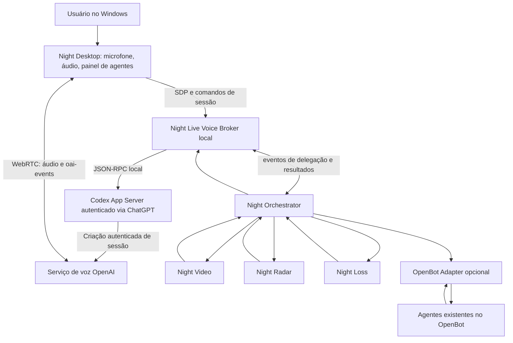

# Night — Voz Live com login ChatGPT/Codex (referência principal: OpenBot)

**Documento de implementação para Claude Code / Codex**  
**Pesquisa:** 18 de novembro de 2026  
**Alvo:** Windows, Night como orquestrador principal, agentes independentes (Night Video, Night Radar, Night Loss e outros), integração opcional com agentes existentes no OpenBot.  
**Estado:** proposta técnica baseada em documentação e projetos públicos. **Não houve execução do código no computador do usuário**, nem validação do acesso da conta dele.

> **Instrução ao implementador:** não reescreva a arquitetura atual do Night. Primeiro examine o repositório, identifique o runtime, os agentes, as filas, as permissões e os eventos existentes; adapte os módulos propostos às interfaces reais. O escopo principal é acrescentar o mesmo **tipo de conexão de voz Codex/WebRTC que o OpenBot utiliza**, não recriar o OpenBot.

## 1. Decisão e fatos comprovados

1. **OpenBot (`nightly-labs/openbot`) é a referência funcional principal.** No modo *Codex live voice*, inicia um processo separado de **Codex App Server**, autentica pela sessão Codex/ChatGPT disponível no host e troca uma **oferta SDP WebRTC** do cliente por uma resposta SDP. O áudio percorre a conexão **cliente ↔ OpenAI**, não o servidor OpenBot. A fala delegada vira mensagem normal para o agente escolhido; a resposta textual do agente volta à camada de voz para ser falada. Veja [documentação de servidores, seção Live voice](https://github.com/nightly-labs/openbot/blob/main/docs/architecture/servers.md) e [política de privacidade, seção de voz](https://github.com/nightly-labs/openbot/blob/main/PRIVACY.md).
2. **O objetivo é usar o login do ChatGPT por meio do Codex App Server, não uma chave de API de voz separada.** Isso é demonstrado também pelo [Codexbot](https://github.com/10K-Digital/codexbot), [Codex Voice](https://github.com/merlinrabens/codex-voice) e [Hermes Live Voice](https://github.com/Synero/hermes-live-voice). É um recurso **experimental**, sujeito à versão, acesso da conta, limites, mudanças de protocolo e políticas aplicáveis. Não prometer disponibilidade garantida nem uso ilimitado.
3. **Não é possível descobrir o transporte de rede desta conversa específica no ChatGPT a partir do Night nem deste assistente.** Esta conversa funcionar mesmo com o Codex limitado demonstra apenas que os caminhos de acesso/limites não são idênticos. **Não** prova que uma sessão Codex Live Voice no Night continuará disponível quando a franquia de tarefas Codex acabar.
4. **O Night deve controlar a conversa, não entregar seu papel de orquestrador ao Codex.** A voz recebe/fala; o Night decide qual agente executa, aplica permissões, preserva estado, acompanha execução e divulga resultados.
5. **Licenciamento:** o OpenBot atual usa **PolyForm Noncommercial 1.0.0** ([LICENSE](https://github.com/nightly-labs/openbot/blob/main/LICENSE)); estudar arquitetura é diferente de copiar código para uso comercial. **Hermes Live Voice** e **Codexbot** publicam licença **MIT**, adequada ao reaproveitamento conforme seus avisos de copyright/licença. A implementação do Night deve ser original ou usar apenas código com direitos compatíveis.

## 2. Projetos encontrados e o que aproveitar

| Projeto | Link | Resultado relevante | Prioridade / cautela |
|---|---|---|---|
| **OpenBot — nightly-labs** | https://github.com/nightly-labs/openbot | Fluxo completo por agente, SDP, host de sessão, delegação de fala para mensagens do chat, integração desktop/remota e CLI de automação | **Referência arquitetural nº 1**; licença não comercial |
| **Hermes Live Voice** | https://github.com/Synero/hermes-live-voice | `codex app-server` + WebRTC v3; `gpt-live-1-codex`; entrega `delegation` ao chat focado; uso de persona e painel de uso | **Referência de código nº 1**; MIT; versão/compatibilidade precisam teste no Windows |
| **Codexbot — 10K-Digital** | https://github.com/10K-Digital/codexbot | Descreve sessão WebRTC v3 usando login ChatGPT, sem API key; relata ida-e-volta real de áudio | **Referência de prova de conceito**; MIT; testes descritos sobretudo em Mac |
| **Codex Voice — merlinrabens** | https://github.com/merlinrabens/codex-voice | Interface simples com app-server; reconexão de voz mantendo thread, memória limitada e aprovação granular | **Referência para estado, continuidade e UX**; confirmar licença da revisão usada |
| **ha-codex-voice — AurelioB** | https://github.com/AurelioB/ha-codex-voice | Ponte de áudio para um thread WebRTC nativo; `oai-events`; buffers, cancelamento e cuidados com interrupção | **Referência de áudio e teste**; para Home Assistant, não transplantar arquitetura inteira |
| **intelligent-3d — GeorgeWingg** | https://github.com/GeorgeWingg/intelligent-3d | `server/voice.mjs` cria um segundo app-server, ativa realtime e retransmite oferta/resposta SDP via `thread/realtime/*` | **Referência enxuta do handshake**, publicada em novembro/2026 |
| **Codex-Voice-Agent — maxrubin629** | https://github.com/maxrubin629/Codex-Voice-Agent | Boa separação entre voz e execução com aprovações, porém **exige `OPENAI_API_KEY`** | **Não** usar como base da autenticação por assinatura |
| **OpenClaw — issue de falha** | https://github.com/openclaw/openclaw/issues/115021 | Há implementação que chega ao início do realtime, mas fica sem resposta SDP; demonstra que handshake precisa timeout e diagnóstico | Usar como **teste negativo**, não como referência funcional |

**Pesquisa no X/Twitter:** não foi encontrado um post verificável com código/fluxo mais sólido que os repositórios acima nesta rodada. **Não tratar posts sem link de código e teste reproduzível como prova.** Pesquisas complementares sugeridas: `"gpt-live-1-codex" "WebRTC"`, `"codex app-server" "voice"`, `"thread/realtime/start" "v3"`.

**Evitar confusão:** há outros projetos chamados “OpenBot” (por exemplo, `CopilotKit/OpenBot` e `docs.openbot.build`). **Não** misturar essas documentações com o OpenBot principal `nightly-labs/openbot`.

## 3. O fluxo exato descrito pelo OpenBot

**Fonte principal:** https://github.com/nightly-labs/openbot/blob/main/docs/architecture/servers.md

- O cliente cria `RTCPeerConnection`, prepara **uma trilha de áudio** e o **data channel `oai-events`** e gera `offer.sdp`.
- Para agentes de servidor vinculado, o cliente manda `POST /v1/live-voice/start` com `{ agentId, sdp, voice? }`.
- O host valida que o membro pode conversar com o agente e que existe conexão de eventos da sessão lógica.
- O host inicia o Codex App Server com sua autenticação (ou a conta Codex específica do agente) e devolve `{ sessionId, sdp }` com a resposta SDP de OpenAI.
- O cliente aplica a resposta com `setRemoteDescription`; **a trilha de áudio circula diretamente entre cliente e OpenAI**.
- O canal de controle/eventos devolve transcrição, eventos de delegação e estado; a fala que requisita uma tarefa vira mensagem **do agente escolhido**, e o texto produzido é encaminhado para ser pronunciado.
- Ao encerrar, `POST /v1/live-voice/stop` com `sessionId`; o host também deve limpar a sessão em desconexão.
- Na implementação documentada do OpenBot há no máximo uma sessão por membro; iniciar outra encerra a anterior. O Night pode adotar esse limite para seu usuário único.
- O projeto relata caminhos e comportamentos diferentes para desktop, mobile e web, dependentes da versão. **Não assumir paridade automática.**

**Fonte de apoio:** https://github.com/nightly-labs/openbot/blob/main/PRIVACY.md

### Diagrama proposto para o Night



**Regra de produto:** uma conexão de voz persistente com o **Night**; quando o usuário diz “Night, chama o Night Video”, o Night delega a tarefa sem precisar destruir e recriar a sessão de áudio. Cada agente tem memória, política, personalidade e thread de trabalho próprios. A identidade vocal pode mudar por configuração quando suportada, mas **trocar de voz pode exigir renegociar a sessão** — veja Codex Voice.

## 4. Protocolo Codex necessário — implementar com detecção de capacidades

**Fontes técnicas:**
- https://github.com/openai/codex/blob/main/codex-rs/app-server/tests/suite/v2/realtime_conversation.rs
- https://github.com/openai/codex/issues/40140
- https://github.com/GeorgeWingg/intelligent-3d/blob/main/server/voice.mjs
- https://github.com/AurelioB/ha-codex-voice/blob/main/protocol/realtime-wire-v2.md

**Preparação:**

1. Instalar uma versão **atual** e verificável do Codex CLI compatível com Windows; registrar a versão nos logs. Antes da integração, executar `codex --version` e `codex login` no perfil do usuário. Confirmar o estado de autenticação **sem expor tokens**, e que o processo herda o ambiente correto. **Não** extrair, copiar ou manipular cookies/tokens internos do aplicativo ChatGPT.
2. Iniciar um `codex app-server` por um adaptador/gerenciador de processos controlado pelo Night, com `realtime_conversation` habilitado onde a versão instalada exigir. Usar comunicação local por `stdio`/JSON-RPC e inicialização com suporte experimental onde necessário.
3. Criar ou retomar thread de voz; ao iniciar áudio, chamar `thread/realtime/start` com transporte `webrtc` e o SDP gerado pelo cliente. Usar versão **v3 quando suportada pelo app-server**. **Não hardcodar um corpo JSON baseado em README antigo:** gerar mensagens pelo esquema de protocolo da versão instalada.
4. Escutar as notificações de início, **`thread/realtime/sdp`**, erro, fim e eventos de delegação. Aplicar `answer.sdp` recebido ao peer do cliente. O retorno do RPC de início **não substitui** a notificação com SDP.
5. Acrescentar dados de controle a `oai-events` conforme o contrato exato do protocolo em uso. Em v3, tratar corretamente a delegação, associação ao `threadId`, geração/turno, correlação de resultado e retorno para fala.
6. Encerrar a sessão por RPC e fechar track, data channel, peer, subprocesso e callbacks. Uma reconexão não deve perder a thread de trabalho nem enviar a mesma tarefa duas vezes.

**Esboço de implementação — deliberadamente não é um payload de protocolo completo:**

```ts
// Night: pseudocódigo; nomes dos métodos conforme a revisão do app-server.
async function startLiveVoice(activeNightConversation: string) {
  const peer = new RTCPeerConnection();
  const mic = await navigator.mediaDevices.getUserMedia({ audio: true });
  mic.getAudioTracks().forEach(track => peer.addTrack(track, mic));
  const events = peer.createDataChannel('oai-events');
  const offer = await peer.createOffer();
  await peer.setLocalDescription(offer);

  // Night broker chama Codex app-server por JSON-RPC:
  // initialize(experimentalApi), thread/start ou resume,
  // thread/realtime/start({ transport: { type: 'webrtc', sdp: offer.sdp }, ... })
  // e AGUARDA a notificação thread/realtime/sdp da mesma thread/sessão.
  const answer = await nightBroker.startCodexVoice({
    conversationId: activeNightConversation,
    sdpOffer: offer.sdp!,
  });
  await peer.setRemoteDescription({ type: 'answer', sdp: answer.sdp });
  return { peer, mic, events, sessionId: answer.sessionId };
}
```

**Cuidado com versões:** uma regressão relatada em agosto/2026 produziu erro de modelo para o realtime com login ChatGPT; uma resposta de mantenedor sugeriu, para **aquela combinação de versões**, explicitar `model: "gpt-live-1-codex"` e `version: "v3"` em `thread/realtime/start`. **Tratar isso como workaround histórico sujeito a compatibilidade, não configuração universal.** Fonte: https://github.com/openai/codex/issues/40140.

## 5. Divisão dos módulos a acrescentar ao Night

Proposta de interfaces (ajustar à estrutura atual, não impor nomes de arquivos):

| Módulo | Responsabilidade | Não deve fazer |
|---|---|---|
| `LiveVoiceUI` | microfone, reprodução, estado connecting/listening/speaking, mute, interromper, hangup, seletor de agente | chamar ferramentas ou guardar credenciais |
| `WebRTCPeer` | uma trilha de áudio, `oai-events`, SDP, ICE, reconexão e playback | selecionar o agente |
| `CodexAppServerBridge` | subprocesso Codex, JSON-RPC, login status, capacidade experimental, notificações, timeout | conhecer regras de negócios dos agentes |
| `LiveVoiceSessionManager` | correlação de `sessionId`/`threadId`/`conversationId`, lifecycle, deduplicação, cancelamento e logs redigidos | guardar áudio por padrão |
| `DelegationAdapter` | traduzir eventos da voz em `NightTaskRequest`; enviar resposta à voz | conceder permissões novas à voz |
| `NightOrchestrator` | identificar agente, criar tarefa, fila, autorização, estado, respostas parciais/finais | depender de um provedor específico |
| `OpenBotAdapter` | usar CLI/API documentada para mandar tarefa a agente OpenBot e obter resultado | pegar tokens privados do OpenBot ou alterar seu banco |
| `FallbackVoice` | ASR/TTS local já existente, ou interface por texto quando Live não estiver disponível | disfarçar a qualidade/latência do fallback |

### Contrato interno sugerido

```ts
type NightTaskRequest = {
  requestId: string;              // UUID para idempotência
  conversationId: string;         // conversa de voz do Night
  targetAgentId: string;          // night-video | night-radar | night-loss | ...
  text: string;                   // intenção finalizada, sem fragmentos
  source: 'live-voice' | 'text';
  requiresApproval?: boolean;
};

type NightTaskResult = {
  requestId: string;
  targetAgentId: string;
  status: 'queued' | 'running' | 'needs_approval' | 'done' | 'failed';
  speakableText?: string;
  details?: unknown;              // não incluir segredos no TTS
};
```

**Orquestração:** `Night` continua sendo o único ponto de entrada. `Night Video`, `Night Radar` e `Night Loss` **não** precisam abrir uma sessão de voz própria para executar cada tarefa. O texto da delegação vai para a thread correta. Se o usuário alternar entre agentes, preservar contexto de cada um. Se pedir “fala com o Night Video diretamente”, marcar o agente como alvo da conversa até ser desativado — mantendo o Night como mediador.

### Night ↔ OpenBot: integração concreta já documentada

Existe um **CLI de automação do OpenBot** que pode ser chamado pelo Night em subprocesso. A documentação mostra o caminho no Windows (`%LOCALAPPDATA%\Programs\OpenBot\resources\cli\openbot-cli.mjs`) e comandos:

```powershell
# Exemplos documentais, NÃO executar sem verificar instalação/permissões.
node "<caminho-do-openbot-cli.mjs>" list
node "<caminho-do-openbot-cli.mjs>" run "Ada" "Execute os testes" --wait
node "<caminho-do-openbot-cli.mjs>" status "Ada" "<deliveryId>"
```

Referência: https://github.com/nightly-labs/openbot/blob/main/docs/automation.md. Para `run`, o agente precisa habilitar **Permissions → Local scripts**; opção desativada por padrão. O CLI retorna códigos distintos para sucesso, erro, aprovação pendente, timeout e OpenBot indisponível. Usar `--id` para idempotência e `--json` quando disponível. **Não presumir que executar tarefas pelo CLI também abre ou controla a sessão de voz do OpenBot**: são integrações diferentes.

## 6. Fluxos de conversa e aprovação

**A. Conversa geral:** “Night, o que o Radar encontrou?” → modelo de voz recebe fala → Night entende intenção → `Night Radar` responde → Night devolve resumo para falar.

**B. Trabalho delegado:** “Night, manda o Video editar os próximos três cortes” → `DelegationAdapter` cria `requestId` → tarefa entra na fila do `Night Video` → voz responde com estado real (“enviei para o Video”, se o envio foi confirmado) → resultado final chega por evento → Night relata.

**C. OpenBot:** “Night, manda o agente X do OpenBot rodar testes” → `OpenBotAdapter` usa `openbot-cli run ... --json` e guarda `deliveryId` → trata execução/pendência → devolve resultado à sessão de voz.

**D. Aprovação:** tarefa pede acesso a arquivo/comando/conta → Night interrompe delegação aguardando decisão explícita do usuário → a voz lê o pedido com detalhes suficientes → somente a confirmação ligada ao ID da aprovação permite prosseguir. Nunca adotar automaticamente o padrão irrestrito `danger-full-access` do OpenBot.

**E. Interrupção:** o usuário fala enquanto a IA fala → interromper **playback local imediatamente**; sinalizar/cancelar a resposta remota quando a sessão confirmar o mecanismo disponível. **Interromper o áudio não implica cancelar uma tarefa que já está rodando.** “Pare a fala” e “cancele o trabalho” são comandos diferentes.

## 7. Limites, estados e fallback

O usuário relatou **Codex de tarefas esgotado até 20/11/2026 às 13:00** e a voz do aplicativo ChatGPT funcionando. Tratar isso como **observação do ambiente do usuário**, não como especificação de billing. O Night deve exibir independentemente:

- Estado de autenticação ChatGPT/Codex.
- Estado da sessão Live (`available`, `connecting`, `connected`, `denied`, `unsupported`, `rate_limited`, `failed`).
- Estado/limites do executor Codex, se disponível pelo mecanismo oficial.
- Estado individual de cada agente (pronto, executando, falha, precisa de aprovação).

**Teste obrigatório:** com o Codex de execução bloqueado, tentar abrir uma sessão Live e realizar uma troca curta de áudio (se permitido); separadamente, pedir execução a um agente. Anotar **códigos de erro e timestamps**, sem credenciais/áudio privado. Três resultados possíveis: (1) voz e tarefas funcionam; (2) voz funciona, tarefas não; (3) voz e tarefas falham. **Não programar como se o caso (2) fosse garantido**.

Fallback: se o fluxo Codex Live não iniciar, oferecer microfone com ASR/TTS local ou entrada de texto, **claramente identificado como fallback**, mantendo orquestração e chats. Nunca usar clandestinamente uma chave de API paga ou uma sessão web do ChatGPT para contornar a limitação.

## 8. Segurança, privacidade e licença

- **Local-first:** subprocesso Codex e roteador do Night no Windows; conexão externa somente para o serviço que realmente processa a voz. A RX 550 não precisa executar o modelo Live na GPU local.
- **Credenciais:** usar autenticação suportada pelo Codex CLI. Não ler `auth.json` de outras aplicações, não exportar refresh tokens, não interceptar cookies nem solicitar credenciais ao usuário dentro da interface do Night.
- **Dados enviados:** voz e parte do contexto de roteamento/instruções seguem ao serviço de voz; textos delegados seguem ao provedor do agente. Mostrar isso nas configurações; não afirmar que o áudio é 100% local.
- **Áudio:** não gravar por padrão. Armazenar no máximo transcrições finalizadas que o usuário autorizar, com retenção configurável e exclusão.
- **Permissões:** tool calls, arquivos, shell, publicação, pagamentos, contas e operações remotas passam pelos controles já existentes. Definir allowlist de ferramentas de voz. Revisar respostas com dados sensíveis antes de falá-las.
- **Resiliência:** timeout, cancelamento, deduplicação de eventos, limpeza de processos órfãos, limitação de duração da sessão, logs com redaction, classificação de erros sem expor stack trace nem segredos.
- **Licenças:** OpenBot PolyForm Noncommercial; Hermes Live Voice e Codexbot MIT. Preservar `LICENSE`/`NOTICE` de qualquer trecho licenciado que seja efetivamente reutilizado; verificar a licença do restante antes de copiar.

## 9. Plano de implementação por fases (entregável ao Claude)

**Fase 0 — auditoria do Night e prova técnica, sem refatoração:**
1. Ler estrutura atual; mapear `NightOrchestrator`, agentes, contratos, transportes e controles de aprovação.
2. Conferir instalação Codex no Windows, login, versão e disponibilidade dos métodos realtime.
3. Criar app/teste mínimo com WebRTC + app-server + uma troca real de áudio e um evento de delegação. Registrar versão e erros.
4. Se a prova falhar por falta de recurso/conta, documentar e interromper apenas o fluxo experimental; não alterar os agentes existentes.

**Fase 1 — adapter de voz do Night:**
5. Implementar `CodexAppServerBridge`, `WebRTCPeer`, `LiveVoiceSessionManager` e interface de status/mute/hangup.
6. Conectar eventos de delegação ao roteador central, com ID de requisição e testes de idempotência.
7. Manter sessão de voz única do Night, com troca de agente sem troca do canal de áudio.

**Fase 2 — agents e OpenBot:**
8. Testar `Night Video`, `Night Radar`, `Night Loss` com histórico separado e um único ponto vocal.
9. Implementar `OpenBotAdapter` via CLI **somente se OpenBot estiver instalado e o agente permitir Local scripts**; estado de fila, aprovação e falha retornando ao Night.
10. Integrar feedback por voz e texto, sem expor secrets nem falar logs longos.

**Fase 3 — robustez:**
11. Adicionar reconexão, VAD/interrupção, `mute`, mudança de dispositivo, preservação de thread, limitação de transcript replay, fallback local e medição de latência.
12. Testar indisponibilidade, limite de uso, reinício do OpenBot, reinício do Night, perda de rede e fechamento abrupto.
13. Documentar comandos reprodutíveis e instruções de rollback; submeter código para revisão do Codex/Claude, conforme escolha do proprietário.

### Critérios de aceite

- [ ] O Night inicia voz via **Codex App Server com login ChatGPT**, sem obrigar `OPENAI_API_KEY`, **quando o recurso estiver disponível à conta**.
- [ ] Há áudio real de ida e volta por WebRTC, registro da resposta SDP e fechamento correto.
- [ ] Interromper fala corta reprodução sem cancelar tarefas por acidente.
- [ ] Os agentes têm chats/estado próprios, mas o usuário pode falar continuamente com o Night.
- [ ] Delegação/resultado/erros são correlacionados por IDs; nenhum trabalho é disparado duas vezes em reconexão.
- [ ] A integração de OpenBot usa interface documentada e respeita autorização local.
- [ ] Um limite do Codex não é confundido com um erro de microfone, e o fallback é explícito.
- [ ] Todas as mudanças têm testes automatizados e pelo menos um teste manual de áudio em Windows.
- [ ] Não há coleta indevida de credenciais, nem código do OpenBot copiado além do permitido pela licença.

## 10. Referências verificadas (links para leitura do implementador)

### Projeto principal / integração com OpenBot

1. OpenBot: https://github.com/nightly-labs/openbot
2. Arquitetura live voice / Team API: https://github.com/nightly-labs/openbot/blob/main/docs/architecture/servers.md
3. Como trata privacidade, Codex e fala delegada: https://github.com/nightly-labs/openbot/blob/main/PRIVACY.md
4. Automação local/CLI para a conexão Night ↔ OpenBot: https://github.com/nightly-labs/openbot/blob/main/docs/automation.md
5. Autenticação/integradores: https://github.com/nightly-labs/openbot/blob/main/docs/architecture/integrations.md
6. Licença (restrição comercial): https://github.com/nightly-labs/openbot/blob/main/LICENSE

### Implementações independentes próximas do mesmo mecanismo

7. Hermes Live Voice: https://github.com/Synero/hermes-live-voice
8. Hermes `dashboard/plugin_api.py`: https://github.com/Synero/hermes-live-voice/blob/main/dashboard/plugin_api.py
9. Hermes `desktop/plugin.js`: https://github.com/Synero/hermes-live-voice/blob/main/desktop/plugin.js
10. Codexbot: https://github.com/10K-Digital/codexbot
11. Codex Voice: https://github.com/merlinrabens/codex-voice
12. ha-codex-voice: https://github.com/AurelioB/ha-codex-voice
13. Intelligent 3D / handshake: https://github.com/GeorgeWingg/intelligent-3d/blob/main/server/voice.mjs

### Protocolo / regressões

14. Testes de protocolo Codex App Server: https://github.com/openai/codex/blob/main/codex-rs/app-server/tests/suite/v2/realtime_conversation.rs
15. Regressão histórica com modelo v3: https://github.com/openai/codex/issues/40140
16. Caso de timeout sem SDP (OpenClaw): https://github.com/openclaw/openclaw/issues/115021
17. Exemplo de cliente diferente que **exige API key** (não usar no fluxo desejado): https://github.com/maxrubin629/Codex-Voice-Agent

---

## Instrução final para o Claude Code

> **Implemente no Night a experiência de voz contínua análoga ao `nightly-labs/openbot`, usando o `codex app-server` autenticado pela conta ChatGPT e o transporte WebRTC v3 quando suportado. Não use a API paga de áudio como solução principal. O Night permanece o supervisor, com uma sessão vocal única e delegação a agentes independentes e, opcionalmente, aos agentes existentes no OpenBot via CLI documentada. Comece por uma prova de conceito no Windows com áudio real e validação das limitações da conta, depois integre por módulos pequenos, testes, logs redigidos e revisão. Preserve a arquitetura atual, as aprovações e a segurança. Não copie o código não comercial do OpenBot para produto comercial. Se o protocolo for incompatível, documente a falha concreta em vez de fingir que funciona.**
